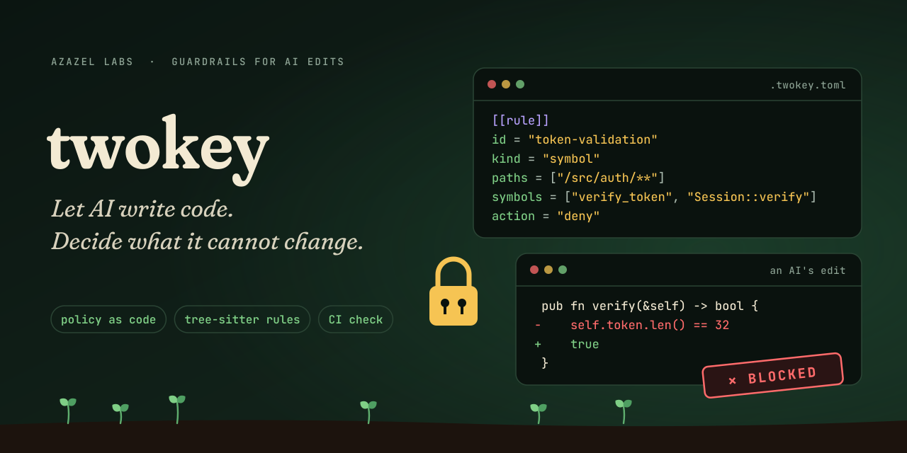
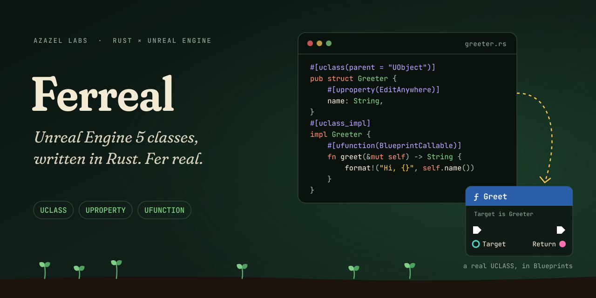
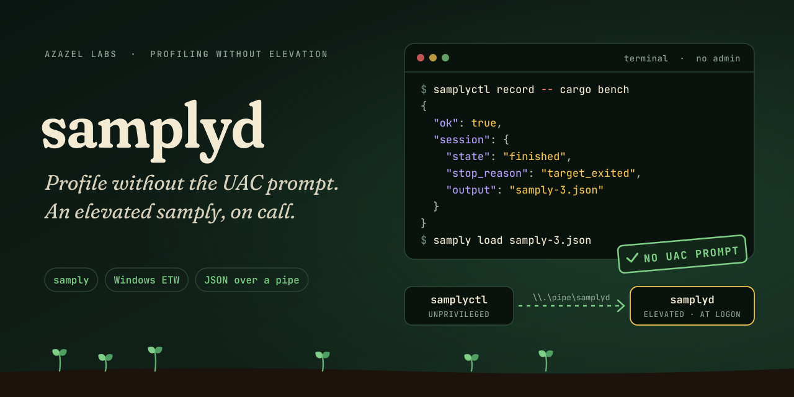

<!-- Images in profile/assets are generated; see profile/assets/README.md. Project images are pulled from each repo's own README art. -->

<a href="https://github.com/Azazel-Labs">
  <picture>
    <source media="(prefers-color-scheme: dark)" srcset="https://raw.githubusercontent.com/Azazel-Labs/.github/main/profile/assets/banner-dark.svg">
    
  </picture>
</a>

  <a href="#-the-garden"><b>The garden</b></a> ·
  <a href="#-how-we-grow"><b>How we grow</b></a> ·
  <a href="#-garden-rules"><b>Garden rules</b></a> ·
  <a href="#-save-the-seeds"><b>Save the seeds</b></a>

## 🌱 How we grow

We use AI the way a gardener uses sun and rain. It does the growing: fast, abundant, and a little wild.

Our job is the gardener's job. We choose the seed and prepare the soil. We stake what leans and prune what sprawls, and we pull the weeds before they choke the bed. Nothing ships just because it sprouted. It ships because someone tended it.

<picture>
  <source media="(prefers-color-scheme: dark)" srcset="https://raw.githubusercontent.com/Azazel-Labs/.github/main/profile/assets/stages-dark.svg">
  
</picture>

<table>
  <tr>
    <td width="130" nowrap><b>🌰 Plant</b></td>
    <td>Every project starts from a small, deliberate seed: a problem we actually have, a clear intent, and a benchmark worth beating.</td>
  </tr>
  <tr>
    <td width="130" nowrap><b>💧 Tend</b></td>
    <td>AI does much of the growing. We water it with context, give it a trellis of tests and measurements to climb, and check on it every day.</td>
  </tr>
  <tr>
    <td width="130" nowrap><b>🪴 Weed</b></td>
    <td>We pull what doesn't belong: dead code, clever hacks, weakened tests, claims we can't back up. We even built a tool for it, <a href="https://github.com/Azazel-Labs/TwoKey">twokey</a>.</td>
  </tr>
  <tr>
    <td width="130" nowrap><b>🧺 Harvest</b></td>
    <td>We ship small, sharp tools with the numbers to prove them, and we keep the seeds free so anyone can replant them.</td>
  </tr>
</table>

## 🌻 The garden

<h3 align="center"><a href="https://github.com/Azazel-Labs/Fresco">Fresco</a></h3>

  A language for GPU-rendered content. <i>Describe what you want to build, in the direction you think about building it</i>, and the compiler does the working-backward. 
  <a href="https://azazel-labs.github.io/Fresco/"><b>▶ Try the playground</b></a> · <code>shaders</code> · <code>language</code>

<table>
  <tr>
    <td width="50%" valign="top">
      <a href="https://github.com/Azazel-Labs/farthing">
        <picture>
          <source media="(prefers-color-scheme: dark)" srcset="https://raw.githubusercontent.com/Azazel-Labs/farthing/main/docs/images/hero-dark.png">
          
        </picture>
      </a>
      <h3><a href="https://github.com/Azazel-Labs/farthing">farthing</a></h3>
      
Makes far things small. LODs, proxies and impostors that still look like the original from where they're seen. Pure Rust, deterministic.

      
<a href="https://azazel-labs.github.io/farthing/"><b>▶ Live demo</b></a> · <code>LOD</code> · <code>3D</code>

    </td>
    <td width="50%" valign="top">
      
      <h3><a href="https://github.com/Azazel-Labs/snugly">snugly</a></h3>
      
Fits your shapes together, snugly. Deterministic 2D atlas packing for rectangles and irregular shapes, holes and overhangs included.

      
<code>atlas packing</code> · <code>UV charts</code> · <code>wasm</code>

    </td>
  </tr>
  <tr>
    <td width="50%" valign="top">
      
      <h3><a href="https://github.com/Azazel-Labs/Hoard">Hoard</a></h3>
      
An asset store with no checkout. Drop in whole asset packs; Hoard dedupes, tags and links them, then serves them to a web portal, a CLI and agents over MCP.

      
<code>game assets</code> · <code>self-hosted</code> · <code>MCP</code>

    </td>
    <td width="50%" valign="top">
      
      <h3><a href="https://github.com/Azazel-Labs/mipple">mipple</a></h3>
      
A rate-distortion optimized GPU texture encoder. BC1–BC7, ETC2, ASTC and KTX2, tuned so Zstd squeezes them even smaller.

      
<a href="https://azazel-labs.github.io/Mipple/"><b>▶ Try it in your browser</b></a> · <code>textures</code> · <code>compression</code>

    </td>
  </tr>
  <tr>
    <td width="50%" valign="top">
      
      <h3><a href="https://github.com/Azazel-Labs/Glyphux">Glyphux</a></h3>
      
Sharp text at any size from multi-channel distance fields, generated on the GPU. Text shaping, color emoji, and CPU generation 3.2–3.9× faster than msdfgen.

      
<a href="https://azazel-labs.github.io/Glyphux/"><b>▶ Live WebGPU demo</b></a> · <code>text</code> · <code>MSDF</code>

    </td>
    <td width="50%" valign="top">
      
      <h3><a href="https://github.com/Azazel-Labs/Clawback">Clawback</a></h3>
      
See where your disk space went. Scans a drive and draws it as a treemap, on Windows, macOS and Linux, as a desktop app or in the terminal.

      
<a href="https://github.com/Azazel-Labs/Clawback/releases/latest"><b>⬇ Download</b></a> · <code>disk usage</code> · <code>TUI</code>

    </td>
  </tr>
  <tr>
    <td width="50%" valign="top">
      
      <h3><a href="https://github.com/Azazel-Labs/TwoKey">twokey</a></h3>
      
Let AI write code. Decide what it cannot change. A policy file fences off your auth logic, existing tests or a few critical lines, and CI enforces it.

      
<code>AI guardrails</code> · <code>CI</code> · <code>the weeding tool</code>

    </td>
    <td width="50%" valign="top">
      
      <h3><a href="https://github.com/Azazel-Labs/Ferreal">Ferreal</a></h3>
      
Unreal Engine, in Rust, fer real. Attributes on Rust items become real <code>UCLASS</code>es, properties and Blueprint nodes, with readable generated C++.

      
<code>Unreal Engine 5</code> · <code>Rust</code> · <code>bindings</code>

    </td>
  </tr>
  <tr>
    <td width="50%" valign="top">
      
      <h3><a href="https://github.com/Azazel-Labs/samplyd">samplyd</a></h3>
      
Profile without the UAC prompt. An elevated <a href="https://github.com/mstange/samply">samply</a> broker starts at logon, and any unprivileged process, agent or test drives it over a local pipe and gets JSON back.

      
<code>profiling</code> · <code>Windows</code> · <code>Rust</code>

    </td>
    <td width="50%" valign="top"></td>
  </tr>
</table>

## 🪴 Garden rules

- **Measure, don't guess.** Benchmarks and side-by-side images ship in the README: farthing's 24 image comparisons, Glyphux against msdfgen, mipple's results tables.
- **Same seed, same plant.** farthing and snugly give the same output on any machine and any thread count.
- **No thorns.** farthing, snugly and the Glyphux library have no `unsafe` code.
- **Fence the beds.** twokey keeps agents out of the code that only a human should change.
- **Try before you dig.** Fresco, farthing, mipple and Glyphux run live in your browser.

## 🧺 Save the seeds

Everything here is **MIT-0**, so take a cutting and plant it in your own garden. If something sprouts, we'd love to see it: open an issue, send a PR, or star the repo so we know it found sun.

  🌱 Planted by people · grown with AI · weeded by hand 🌱

